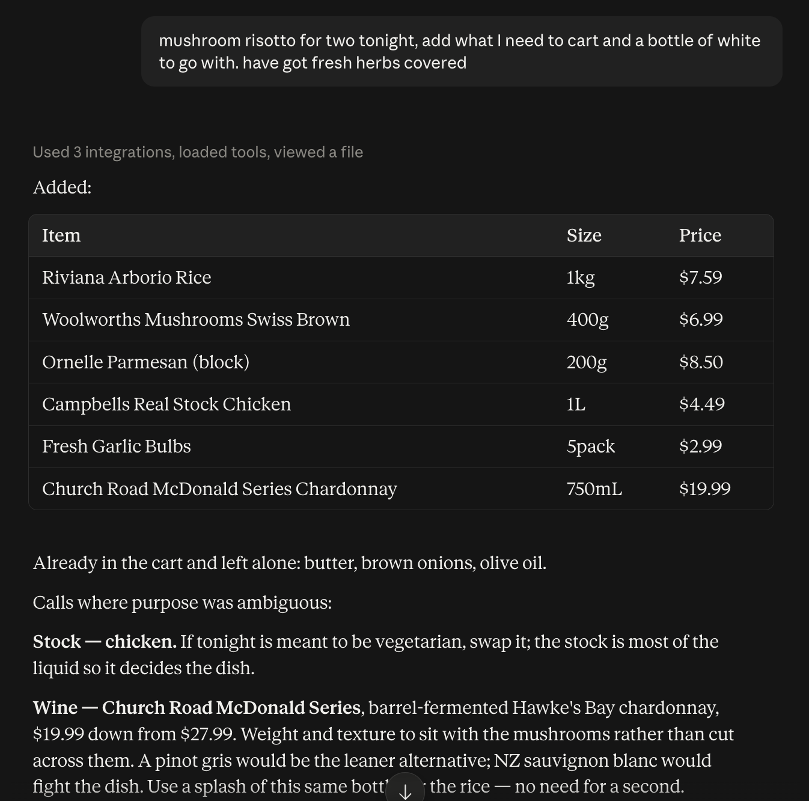

# woolies-mcp

An MCP server for shopping the [Woolworths New Zealand](https://www.woolworths.co.nz) catalogue:
keyword search, product detail, and the delivery location those answers depend on.



The catalogue tools are read-only and need no account. Once signed in it can also read and fill
your trolley — but it never places an order, pays, or books a delivery slot.

**It keeps itself signed in.** Store your Woolworths login once with `npm run credentials` and the
server signs in again whenever the session dies, stopping at the first failure rather than
retrying against your account. Prefer not to store a password? `npm run login` opens a browser
for you to sign in, and the server keeps only the resulting session. See [DESIGN.md](DESIGN.md)
for the API facts and the rules the server holds to, and [CHANGELOG.md](CHANGELOG.md) for what
changed and how to upgrade.

This is an unofficial project, not affiliated with Woolworths — please read
[Unofficial, and what this is not](#unofficial-and-what-this-is-not) before using it.

## Contents

- [Tools](#tools)
- [Requirements](#requirements)
- [Run it](#run-it)
- [Add it to Claude Code](#add-it-to-claude-code)
- [Shopping skill](#shopping-skill-recommended)
- [Running it over HTTP](#running-it-over-http) — [Docker](#docker), [Synology NAS](#deploying-to-a-synology-nas-optional), [Tailscale Funnel](#publishing-with-tailscale-funnel-optional)
- [Politeness](#politeness)
- [Layout](#layout)
- [Restore](#restore)
- [Upgrading](CHANGELOG.md#upgrading-from-10)
- [Unofficial, and what this is not](#unofficial-and-what-this-is-not)

## Tools

| Tool                                                                    | What it does                                                                                                                                                                 |
| ----------------------------------------------------------------------- | ---------------------------------------------------------------------------------------------------------------------------------------------------------------------------- |
| `search_products(query, page?, sort?)`                                  | Keyword search. Returns products with the `variantKey` a cart write targets, `matchesAvailable` and a coverage line.                                                          |
| `search_products_batch(queries, resultsPerQuery?)`                      | Several searches in one call, grouped by query.                                                                                                                              |
| `get_product(sku)`                                                      | One product by SKU: ingredients, allergens, nutrition panels, warnings, barcode, and every way it is sold.                                                                    |
| `get_product_label(sku)`                                                | The product's own image URLs. The site does not say which, if any, shows the label.                                                                                          |
| `get_location()`                                                        | Where the cart is being delivered, and the account's other saved addresses.                                                                                                  |
| `list_categories(categoryKey?)`                                         | The browse tree: one node with its children. Each carries the key `browse_category` takes.                                                                                   |
| `browse_category(categoryKey, page?, sort?)`                            | Products in a category, by the key `list_categories` returns.                                                                                                                |
| `get_specials(filters?, page?, sort?)`                                  | What is on special, optionally narrowed to one promotion type.                                                                                                               |
| `get_delivery_windows(locationId?, availableOnly?)`                     | Delivery and pick-up windows with their fee bands. Read-only: no tool books one.                                                                                             |
| `find_stores(query?)`                                                   | Pick-up locations nearest the cart's delivery address, with how far away each is.                                                                                            |

| `set_location(addressId)`                                               | Moves the cart to another of the account's saved addresses. Books nothing.                                                                                                   |

### Account tools

| Tool                                            | What it does                                                                    |
| ----------------------------------------------- | ------------------------------------------------------------------------------- |
| `auth_status()`                                 | Whether the account tools work, demonstrated by a real call. Read-only.         |
| `sign_in()`                                     | Reports how to sign in; the server cannot do it unattended (see below).         |
| `get_cart()`                                    | What is in the cart, with the totals and anything blocking checkout.            |
| `set_cart_quantity(sku, quantity, pricingUnit)` | Sets a line to an absolute quantity; 0 removes it. Decimals for `Kg`.           |
| `set_cart_quantities(items)`                    | Several lines in one call, with a per-item outcome.                             |
| `remove_from_cart(sku)`                         | Removes a product from the cart, whichever pricing it is held under.            |
| `get_buy_it_again(page?)`                       | The site's "Buy it again" list, frequency-ordered. Not the full purchase history. |
| `get_order_history(filter?, page?)`             | Past or in-flight orders, with their fulfilment slots and totals.               |

The server keeps itself signed in. Give it your Woolworths email and password once with
`npm run credentials`, and whenever the site refuses the session it signs in again, the way the
website's own login form does, saves the new session, and retries the call. It stops at the first
failure — a wrong password, a captcha, anything unexpected — and says why, rather than trying
again against your account; the stop clears when you rewrite the credentials, hand over a browser
session, or restart. Without a credentials file, `npm run login` opens a real browser for you to
sign in and hands the session over. `auth_status` makes a real account call and reports what it
demonstrated, so it cannot claim access the tools do not have.

Woolworths is moving the site from its old REST API to a new GraphQL one. This server has followed
it completely: every call it makes is GraphQL. The catalogue still works without an account — the
site serves a guest — so search, browse, specials and product detail need no sign-in. Everything
about *your* shop does: the cart, where it goes, the windows offered there, and your history.

> **An expired session does not make the cart look empty.** The new API answers an
> unauthenticated caller with an empty *guest* cart at HTTP 200 rather than an error. Every cart
> call here proves whose cart it is on the same request, so an empty cart these tools report is
> genuinely empty.

**No checkout, ever.** There is no tool for placing an order, paying, or booking a delivery slot,
and the upstream endpoints for those are deliberately left unbound. A person reviews the cart
and places the order on the website.

> **Quantities can change on the way in.** Woolworths rounds weight-priced products up to a whole
> number of items, so 0.3 kg of loose bananas becomes 0.5 kg. Cart writes return
> `requestedQuantity` and `appliedQuantity` separately and set `adjusted` with an explanation
> when they differ. Report what was applied, never what was asked for.

`npm run smoke:account` runs the cart sequence and restores the cart; `npm run check:login`
checks the sign-in chain without credentials; `npm run check:credential-signin` checks automatic
sign-in against a stubbed site; `npm run check:adjustment` and
`npm run check:graphql-cart` check the quantity-adjustment wording and the GraphQL cart contract
offline.

## Requirements

Node 20 or newer. The catalogue tools need no account; the cart tools need `npm run credentials`
or `npm run login`.

## Run it

```sh
npm install
npm run build
npm start          # stdio; speaks JSON-RPC on stdout, logs on stderr
```

`npm run check` runs typecheck, lint, format check and build — the pre-push command. `npm run
lint:fix` and `npm run format` apply what is fixable. CI runs the same four on Node 20 and 22.

`npm run smoke` exercises the live API end to end against its own anonymous session, throttled to
one request per second, and prints a pass/fail line per check. `npm run typecheck` covers `src`
and `scripts`.

## Add it to Claude Code

From anywhere, after `npm install && npm run build` in this directory:

```sh
claude mcp add woolies --scope user -- node /absolute/path/to/woolies-mcp/dist/index.js
```

Drop `--scope user` to register it for the current project only. Check it with
`claude mcp list`, and remove it with `claude mcp remove woolies`.

## Shopping skill (recommended)

The tools alone leave the caller to work out the order of operations. `skills/woolies/` is an
[Agent Skill](https://agentskills.io) that supplies it: check the delivery location before
quoting prices, resolve each list item, batch the cart write, and report ambiguous picks
instead of choosing silently. Worth adding once the server is connected.

```sh
ln -s "$PWD/skills/woolies" ~/.claude/skills/woolies      # Claude Code
```

Copy it instead of symlinking if you want to tailor it — pointing it at wherever you keep your
shopping lists and preferences is the main thing worth changing. For claude.ai, upload it in the
skills settings; its frontmatter is limited to the Agent Skills spec so it uploads unchanged.

Then ask for the shopping in the normal way, or invoke it directly with `/woolies`.

## Running it over HTTP

Two entry points share one `createServer`:

| Entry           | Command              | Used for                             |
| --------------- | -------------------- | ------------------------------------ |
| stdio           | `node dist/index.js` | local use, launched by an MCP client |
| Streamable HTTP | `node dist/http.js`  | remote use over HTTP                 |

`node dist/http.js` serves the same tools over Streamable HTTP, which is what a hosted MCP client
connects to. Any host that runs Node or Docker will do; the sections below describe one
arrangement, and none of it is required for local stdio use.

There are two ways to guard it, and only one is on at a time.

By default the transport serves MCP **only** at `/mcp/$MCP_PATH_TOKEN`. `/healthz` returns a
version string with no secrets, and every other path returns 404 with an empty body. The token is
an unguessable path, not authentication: it travels in the URL, so it ends up in the client's
configuration and anywhere that URL is logged. It guards a session that can read and fill the
signed-in trolley, so treat the token as a credential.

Setting `MCP_PUBLIC_URL` turns on the built-in OAuth authorisation server instead. MCP then lives
at `/mcp` behind a bearer token, the token path serves nothing but the `npm run login` handover,
and a client authorises itself by sending you to a consent page. See
[Authorising a hosted client](#authorising-a-hosted-client-optional).

Copy `.env.example` to `.env` and fill it in. Generate the token with `openssl rand -hex 24`.

### Docker

`docker-compose.yml` builds the image, reads `.env`, and binds to `127.0.0.1:8480` — a reverse
proxy or tunnel is expected to publish it, not the port itself. Create `data/` next to the compose
file and `chown 1000:1000` it: the container runs as the unprivileged `node` user and stores the
signed-in session there.

```sh
docker compose up -d
```

### Deploying to a Synology NAS (optional)

One convenience path, not a requirement — any host that runs `docker compose` works, by whatever
means you already use.

Prerequisites:

- DSM 7 with Container Manager installed, which provides `docker` and compose v2.
- SSH enabled, and an ssh alias with key auth for a user with passwordless sudo. Docker needs
  sudo on DSM.
- The deploy directory created on the NAS, containing a `data/` subdirectory owned by `1000:1000`.
  The container runs as the unprivileged `node` user and stores the signed-in session there.
- For Funnel only: the Tailscale package sideloaded from
  [pkgs.tailscale.com](https://pkgs.tailscale.com/stable/#synology) — the Package Center build
  lags badly — with HTTPS certificates and Funnel enabled for the tailnet.

Set `DEPLOY_SSH_HOST` to the ssh alias and `DEPLOY_REMOTE_DIR` to the deploy directory, then:

```sh
npm run deploy            # or: npm run deploy -- my-nas
```

It ships HEAD as a tarball over SSH rather than using scp, because DSM disables SFTP and this way
the NAS needs no git credentials. It copies `.env` only when the NAS has none, builds the image
there, and waits for `/healthz`. It refuses to run with a dirty tree, since HEAD is what ships.

Non-login SSH on DSM has a minimal PATH, so docker is called by absolute path with sudo;
`DEPLOY_DOCKER_PATH` overrides that for other hosts.

### Publishing with Tailscale Funnel (optional)

A hosted MCP client calls the endpoint from the internet, so a LAN address will not do. Funnel
gives the host a public HTTPS URL with no open ports, no domain and no certificates:

```sh
tailscale funnel --bg 8480
```

Enable HTTPS certificates and Funnel once for the tailnet in the Tailscale admin console; the
first `funnel` run prints an approval link if the policy has not been set. The resulting hostname
is `<node>.<tailnet>.ts.net` — put it in `PUBLIC_BASE_URL`.

Whole-port Funnel is safe here because the app serves only what it means to: MCP behind its guard,
`/healthz`, and — when OAuth is on — the discovery, registration, consent and token endpoints.
Every other path returns 404 with an empty body.

Verify from outside:

```sh
npm run check:http <public-base-url> <token>
```

Then give the server your Woolworths login, which the cart tools need. It prompts, with the
password hidden, and writes it to `data/credentials.json` on the deploy target, readable only by
the container:

```sh
npm run credentials
```

The server signs in on its next start or its next account call, and again whenever the session
dies. To sign in through a browser instead, with no password stored:

```sh
npm run login -- --server <public-base-url>/mcp/<token>
```

Substitute the `PUBLIC_BASE_URL` and `MCP_PATH_TOKEN` values from your `.env`; `check:http` and
`login` do not read it for you.

### Authorising a hosted client (optional)

A hosted client such as claude.ai will not hold a secret URL for you; it expects to authorise
itself. Setting `MCP_PUBLIC_URL` and `MCP_AUTH_PASSPHRASE` turns on an authorisation server built
into this one, and the connector address becomes the plain `https://<host>/mcp`.

```sh
npm run check:oauth       # the whole flow, on loopback, touching nothing
```

What the client does, all of it standard: it fetches
`/.well-known/oauth-protected-resource`, follows that to `/.well-known/oauth-authorization-server`,
registers itself at `/register` (RFC 7591), and opens `/authorize` in your browser. That page names
the client, states whether the Woolworths session is currently signed in, and asks for
`MCP_AUTH_PASSPHRASE`. Approving it returns a code, which the client exchanges at `/token` with
PKCE S256 for an access token good for an hour and a rotating refresh token.

Two credentials, doing different jobs: `MCP_AUTH_PASSPHRASE` authorises a client to this server;
your Woolworths login signs this server in to the site. Neither can substitute for the other, and
a dead Woolworths session never costs the client its token.

Five wrong passphrases lock the consent page for fifteen minutes. Registration is open, which is
what dynamic client registration means — the passphrase is what actually guards the account, so
give it the strength of one.

## Politeness

One session, one request per second, a single retry with backoff, and an automatic re-bootstrap
when the edge rejects the session. This is one shopper's traffic and must stay that way; the
throttle lives in `WoolworthsClient` so no tool can route around it.

## Layout

```
src/
  index.ts              stdio entry point
  http.ts               Streamable HTTP entry point
  server.ts             tool registration, transport-agnostic
  config.ts             environment parsed once, at startup
  session-store.ts      the signed-in session on disk, shared by both entry points
  oauth/                the authorisation server: discovery, registration, consent, tokens
  tools/                MCP adapters: argument schemas, descriptions, JSON responses
  woolworths/
    session.ts          cookie jar, browser headers, bootstrap
    graphql-client.ts   the client, the session upgrade, and errors as exceptions
    graphql-documents.ts the operations sent, and the variant-key encoding
    graphql-cart.ts     every operation, with the guest-cart and wrong-cart guards
    credential-signin.ts signing in from stored credentials, and the limits on attempts
    auth.ts             the not-signed-in error and its wording
    schemas.ts          zod schemas for the site's payloads
    mappers.ts          raw JSON to the compact shapes a client sees
    api.ts              the Woolworths operations, in domain terms
scripts/
  credentials.ts        stores the Woolworths login, password hidden
  login.ts              browser sign-in handover
  smoke.ts              live catalogue check
  account-smoke.ts      live cart check, signed in
  browser-fetch.ts      a fetch backed by a real browser's cookies, for the sign-in probes
  cart-fixtures.ts      canned GraphQL carts, so the offline checks stay offline
  deploy.ts             ship, build and start on a remote host
```

## Restore

This repository plus one git-ignored `.env` recreates the deployment. The state under `/data` is
the session, the OAuth clients and the stored login; losing it costs one `npm run credentials`
and reconnecting the client.

For the local stdio server: `git clone`, `npm install`, `npm run build`, and register it with your
client (the `claude mcp add` line above, for Claude Code).

To rebuild the NAS deployment from nothing:

1. `git clone` this repository on the machine you deploy from.
2. `cp .env.example .env` and paste `MCP_PATH_TOKEN` back from your password manager. Reusing the
   same token keeps the existing connector URL working; a new one changes the URL and every client
   must be updated.
3. On the NAS, create the deploy directory's `data/` and `chown 1000:1000` it — the
   container runs as the unprivileged `node` user and stores the session there.
4. `npm run deploy` — ships HEAD to `DEPLOY_REMOTE_DIR`, builds, starts, waits for health.
5. `sudo /var/packages/Tailscale/target/bin/tailscale funnel --bg 8480` on the NAS, if the serve
   config was lost too.
6. `npm run check:http <public-base-url> <token>`.
7. `npm run credentials` to store the Woolworths login again.

Keep copies of every secret in your password manager; none belongs in this repository.

## Unofficial, and what this is not

Not affiliated with, endorsed by, or connected to Woolworths New Zealand or Woolworths Group. All
trademarks belong to them.

It automates one person's own account for their own household shopping: the same actions a shopper
takes in the browser, at a shopper's volume. It is not a scraper, a price-harvesting tool, or a
data-collection service, and the code is built so it cannot drift into being one — a single shared
session, roughly one request per second enforced in the HTTP client where no tool can bypass it,
no bulk crawling, and no redistribution of catalogue or price data. Results are fetched on demand
for the person asking and are not stored or republished.

It intentionally cannot place orders, pay, or book delivery slots. Those endpoints exist upstream
and are deliberately left unbound. Filling a trolley is as far as it goes; a person opens the
website to check out.

The project and its author collect nothing. There is no telemetry and no phoning home. Your
session cookies, stored login, `.env` and any personal data stay in your own deployment, on your
own machine.

You are responsible for complying with Woolworths' Terms of Service — read them and decide for
yourself whether this use fits. It drives the website's own internal API, which carries no
compatibility promise and can change without notice; the schemas are strict so an upstream change
surfaces as an error rather than as wrong data. Use at your own risk. Provided as-is, with no
warranty of any kind.

MIT licensed.
